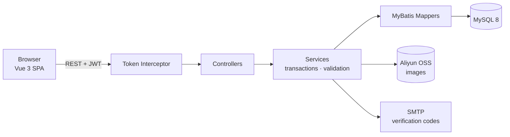

# LivDays — Campus Forum Platform

    

A full-stack community platform for University of Liverpool students. Users sign up with an email verification code, then share posts with images, discuss them in threaded comments, like content, find popular topics, and message each other one-to-one.

The project has a **Spring Boot 3 REST API** and a **Vue 3 single-page app**. It uses stateless JWT authentication, MySQL with MyBatis, and Aliyun OSS for image storage, and it can be deployed with Docker.

---

## Highlights

- **Stateless authentication**: a custom Spring MVC interceptor validates JWTs (HS256) and puts the current user into each request. Every write operation takes the user identity from the token, never from the request body. Logout revokes tokens through a blacklist. Passwords are hashed with BCrypt.
- **Email-verified registration**: a time-limited 6-digit code is sent over SMTP. Codes can be re-issued, and an unfinished sign-up can never be used to log in.
- **Private messaging**: conversations are stored once per user pair (enforced by a unique constraint) and keep a separate unread counter for each side. Deleted conversations are soft-deleted and come back automatically when a new message arrives.
- **Consistent data under concurrency**: duplicate likes are blocked by a composite unique key as well as an application-level check. Denormalised counters for likes, comments and views are updated inside transactions, so lists stay cheap to load.
- **Unified API contract**: every endpoint returns `{code, msg, data}`. A global exception handler maps validation and business errors to readable messages, and the Axios layer on the frontend turns them into UI notifications and redirects to login on `401`.
- **Twelve-factor configuration**: database, mail, JWT secret and OSS credentials all come from environment variables. Local development works with no external services, because verification codes fall back to the console.
- **Container-ready**: a slim JRE 17 Docker image, and frontend builds that target different backend URLs through Vite environment files.

## Tech Stack

| Layer | Technologies |
|---|---|
| **Backend** | Java 17 · Spring Boot 3.4 (Web, Validation, Mail) · MyBatis · PageHelper · JJWT · Spring Security Crypto (BCrypt) · Lombok |
| **Data & Storage** | MySQL 8 · Aliyun OSS |
| **Frontend** | Vue 3 (Composition API) · Vue Router 4 · Element Plus · Axios · Vite |
| **DevOps** | Maven · Docker · environment-based configuration |

## Architecture



## Features

| Area | What users can do |
|---|---|
| Account | Sign up with an email code, log in and out, edit their profile, see their own posts |
| Posts | Browse a paginated feed, search by keyword, see a "popular" ranking by likes, open post details with images and view counts, create posts |
| Comments | Comment on posts; the API supports threaded replies |
| Likes | Like posts and comments, with duplicates blocked |
| Messages | Chat one-to-one with any author; the API also provides a conversation list, unread counts and read status |
| Uploads | Upload images to cloud object storage |

## Getting Started

**Prerequisites:** JDK 17, Node.js 18+, MySQL 8

```bash
# 1. Database: creates the LivDayDB schema and sample data
mysql -u root -p < forumCopy.sql

# 2. Backend: http://localhost:8080
cd forumParent/forum
DB_PASSWORD=<your-mysql-password> mvn spring-boot:run

# 3. Frontend: http://localhost:5173
cd FrontEnd/Frondend-src
npm install && npm run dev
```

**Demo login:** `user01` / `hashed_password_1`

<details>
<summary>Environment variables</summary>

| Variable | Default | Purpose |
|---|---|---|
| `DB_URL` | `jdbc:mysql://localhost:3306/LivDayDB?...` | JDBC URL |
| `DB_USERNAME` / `DB_PASSWORD` | `root` / empty | Database credentials |
| `MAIL_USERNAME` / `MAIL_PASSWORD` | empty | SMTP account. If unset, codes are logged to the console. |
| `JWT_SECRET` | dev key | Signing key (32+ characters); **override in production** |
| `OSS_ACCESS_KEY_ID` / `OSS_ACCESS_KEY_SECRET` | — | Image upload |
| `SERVER_PORT` | `8080` | HTTP port |

</details>

<details>
<summary>Docker deployment</summary>

```bash
cd forumParent/forum && mvn clean package -DskipTests
cp target/forum-0.0.1-SNAPSHOT.jar ../../Deploy_backend/
docker build -t livdays-backend ../../Deploy_backend
docker run -d -p 8080:8080 \
  -e DB_URL=... -e DB_PASSWORD=... -e JWT_SECRET=... \
  livdays-backend
```

</details>

## Project Structure

```
forumParent/forum/          Spring Boot backend
  ├─ controller/            REST endpoints (auth, users, posts, comments, likes, messages, upload)
  ├─ service/               business logic and transactions
  ├─ mapper/ + *.xml        MyBatis data access
  ├─ interceptor/           JWT authentication
  └─ exception/             unified error handling
FrontEnd/Frondend-src/      Vue 3 + Vite frontend
forumCopy.sql               schema and sample data
Deploy_backend/             Dockerfile
```

## Roadmap

- Frontend for image upload, threaded replies and a message centre (the APIs already exist)
- Unlike, plus edit/delete for posts and comments
- Interest tags and notifications
- Real-time messaging over WebSocket
- Redis-backed token revocation and rate limiting
- Splitting the main view into routed components, and adding Pinia and TypeScript
- Automated tests and a CI pipeline
